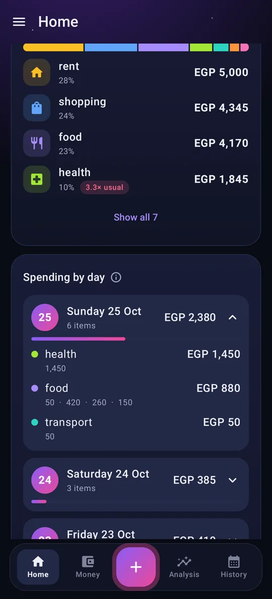
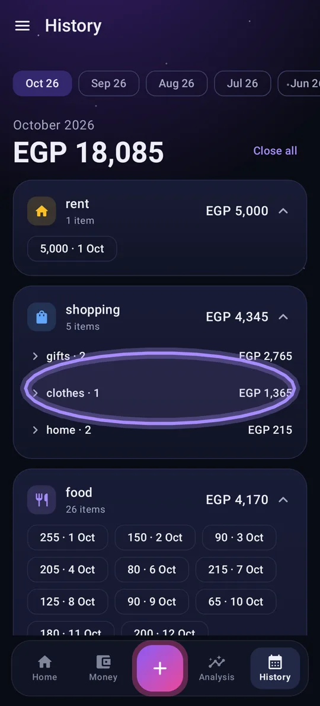
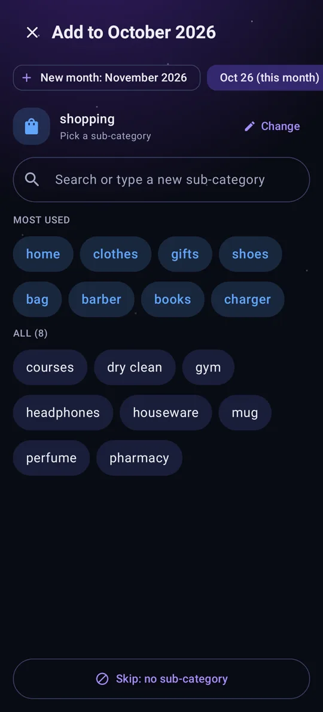
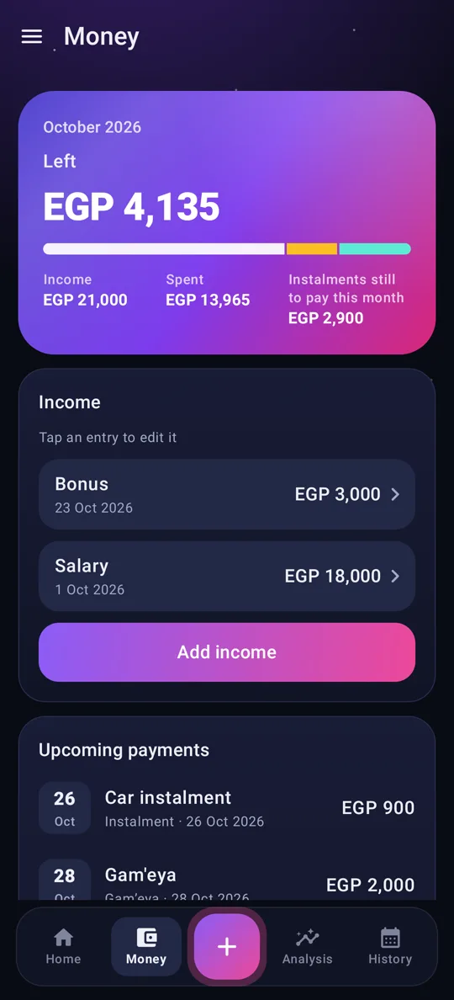
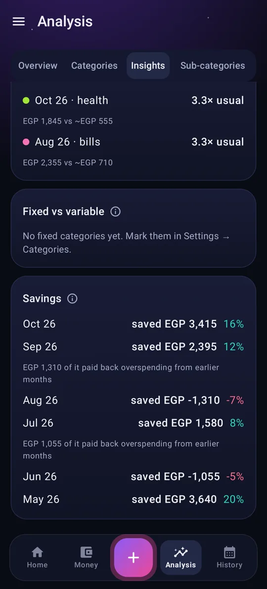

# Buddy Expense Analysis

**Your money, in your own Excel file, with a Buddy who notices. An Android app with no account and no server.**

Every expense is a cell in a normal `.xlsx` file on your phone that you can open in Excel any time. The app reads it, writes to it, and makes sense of it: where the money went, what's unusual for you, what's due next, and what's left.

**[See the full page with every screen →](https://mohamed-ibrahim47.github.io/buddy-expense-analysis-showcase/)**

> The source code is private. This page shows what the app does and how it works.

<!-- Store badge goes here once the app is live on the Galaxy Store -->

## Screenshots

Real screens from the app's demo mode.

| Home | Where it went | Circle to sum | Add an expense |
|---|---|---|---|
|  |  |  |  |

| Money | Credit cards | Analysis | Insights |
|---|---|---|---|
|  |  |  |  |

| Bank SMS | Wallets | Buddy's voices | بالعربي |
|---|---|---|---|
|  |  |  |  |

## The core idea: Excel is the database

- **One sheet per month** (`oct 26`), one column per category. Every amount is a cell you can see.
- **Sub-categories are cell notes**, and hidden sheets keep the app's log and settings.
- **Typed something straight into Excel?** The app picks it up next time it opens.
- **Every save is checked** (zip structure and checksums) before it replaces your file, and a backup is kept.

Nothing is sent anywhere. The app doesn't even ask for internet access.

## What it does

- **Every day**
  - **Add in seconds:** category, amount, Save. Sub-categories show your most used first, the rest A to Z, and a new one is one tap away.
  - **Spending by day.** Raise an amount a week later and only the extra counts on the new day.
  - **Circle to sum.** In History, hold, then draw a loop around amounts, like circling something to search it. Their total shows on top.
  - **A change log for every amount:** when it was added, raised, moved or typed in Excel, as before-and-after cards.
  - **Big numbers welcome:** amounts into the billions, with commas as you type.
- **Money in and out**
  - **What's left** this month after everything still due, with income, spent and due side by side.
  - **Credit cards** stacked like a phone wallet; **instalments, loans and gam'eya** as progress rings with the next payment and your payout turn.
  - **Next salary:** buy now, and the amount comes off the next income you add.
  - **Overspending carries over** (a setting): went past your income on credit? Next month starts in the negative until a good month pays it back.
  - **Month-end savings:** ended a month with money left? Home offers to put it in a Savings wallet in one tap.
  - **Wallets** for pocket money or a trip: all expenses, picked ones, or certain categories. A wallet stops at zero.
  - **Bank SMS** (optional): turn your bank's messages into expenses or income, grouped by day. Nothing is added by itself.
- **Analysis**
  - **Your average month**, and each category this month next to its usual.
  - **Where it went** for all time or any year, a trend per category, and sub-categories broken down.
  - **Unusual months** flagged, fixed costs against variable ones, and what each month saved, including how much of it paid back an earlier overspend.
- **Getting started**
  - **A setup tour** that starts with your categories and income, then shows each tab.
  - **Tips** behind every ⓘ, and a demo mode to try everything with made-up data.
  - **Arabic and English**, fully right to left, with Egyptian Arabic for Buddy's voice.

## How the Buddy works

The Buddy isn't a list of fixed reminders. It works in three steps, all on the phone:

| Step | What happens |
|---|---|
| **Signals** | The app reads your ledger and finds what's worth saying: a category far ahead of its usual pace, a day with nothing logged, a month going over income, a wallet about to run out. |
| **Voices** | Each signal is said in the voice you pick (savage, drama, funky, grandma, coach, or "surprise me") and from a different angle, so the same fact never sounds the same twice. |
| **Timing** | A light alarm wakes the app at a sensible hour, it picks the strongest signal, and shows one notification. At most twice a day, never at night, and quiet when there's nothing to say. |

## Privacy

No account, no login, no internet permission, no analytics, no ads. Your file stays on your phone, with a backup before every change. Full details in the **[privacy policy](https://mohamed-ibrahim47.github.io/buddy-expense-analysis-showcase/privacy.html)**.

## How it's built

- **Kotlin + Jetpack Compose**, Material 3 in a "Night Sky" look: four swipeable tabs, a floating bottom bar and a side menu.
- **Apache POI** reads and writes the workbook, and known causes of "Excel says the file is damaged" are repaired on load.
- **A pure-Kotlin core module** holds all the money logic (daily spending, wallets, carry-over, cards, gam'eya, SMS parsing, the Buddy), covered by 290+ unit tests.
- **Two builds:** one that reads the bank SMS inbox, and one without any SMS permission (paste or share a message instead).

## Coming next

- **Buddy Assistant:** ask about your money, get advice after a heavy month, and plan what to save.
- **Receipt scanning:** take a picture, and the app reads it and suggests a category.

---

Made by [Mohamed Ibrahim](https://github.com/mohamed-ibrahim47) · [Privacy policy](https://mohamed-ibrahim47.github.io/buddy-expense-analysis-showcase/privacy.html)
