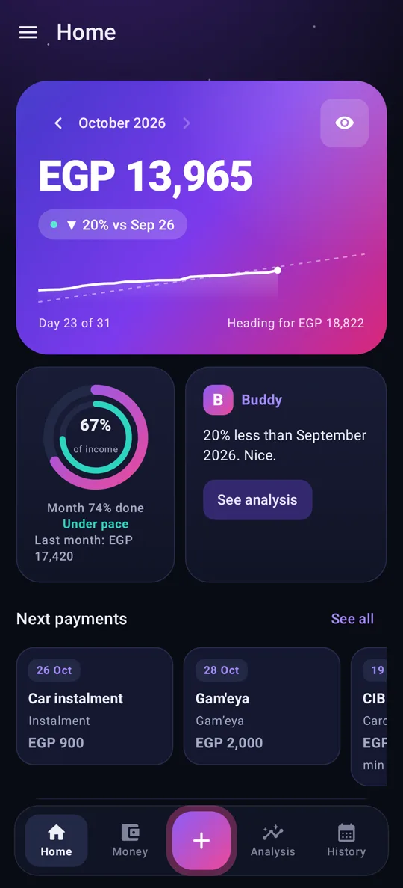
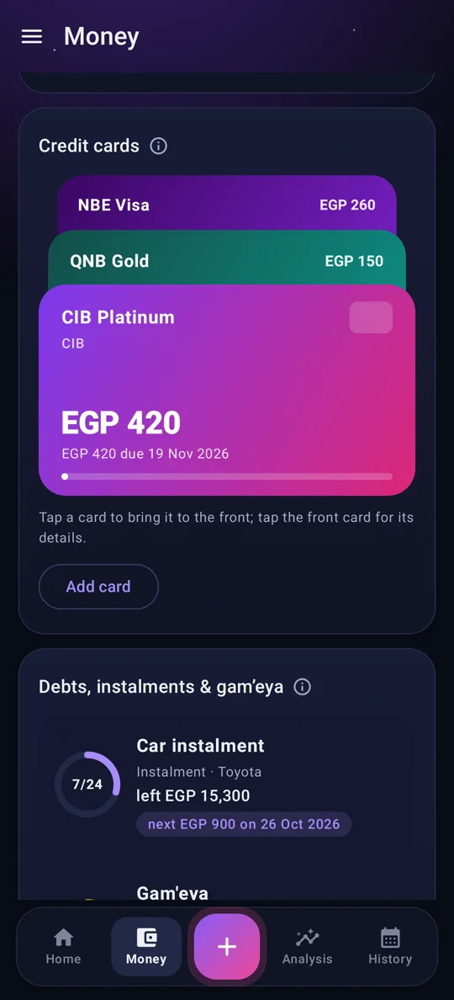
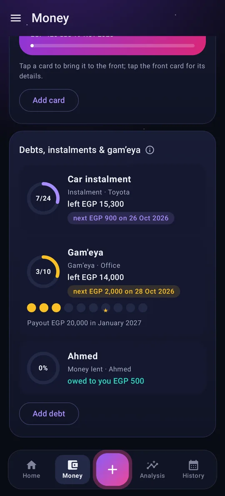
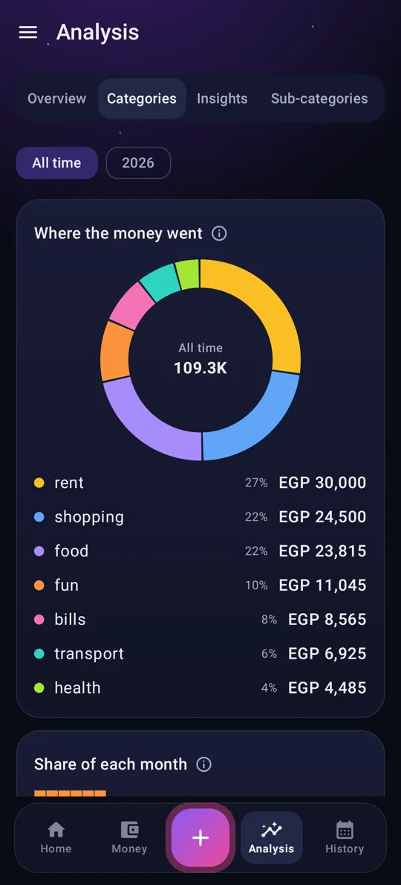
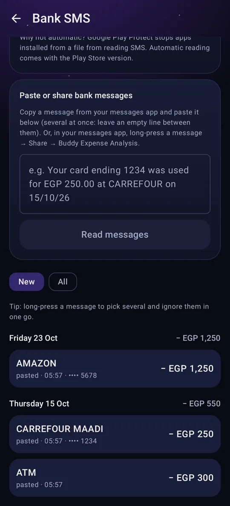
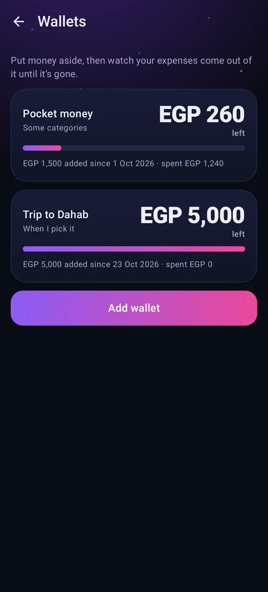
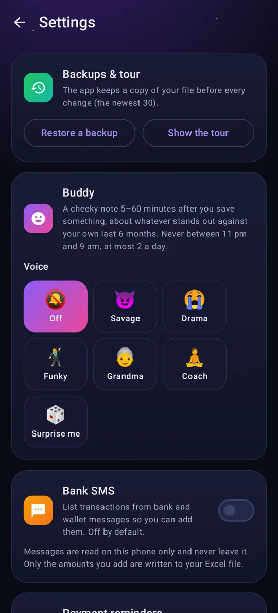
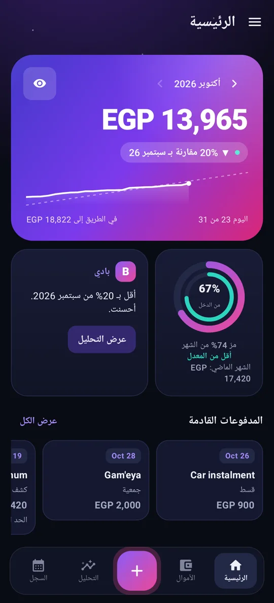

# Buddy Expense Analysis

**A personal finance app for Android that keeps your money in your own Excel file, and a Buddy that tells you when you're slipping.**

No account, no server, no internet permission. Your spending lives in a normal `.xlsx` file on your phone that you can open in Excel any time. The app reads it, writes to it, and makes sense of it.

> The source code is private. This page shows what the app does and how it works.

<!-- Store badge goes here once the app is live on the Galaxy Store -->

## Screenshots

See the full page with all screens at **[mohamed-ibrahim47.github.io/buddy-expense-analysis-showcase](https://mohamed-ibrahim47.github.io/buddy-expense-analysis-showcase/)**.

| Home | Credit cards | Debts & gam'eya | Analysis |
|---|---|---|---|
|  |  |  |  |

| Bank SMS | Wallets | Buddy's voices | بالعربي |
|---|---|---|---|
|  |  |  |  |

## What it does

- **Excel as the database.** Every amount is a cell in a month sheet (`oct 26`), sub-categories are cell notes, and hidden sheets keep the app's log and settings. Typed something straight into Excel? The app picks it up.
- **Spending by day.** See what you spent each day. Raise an amount a week later and only the extra counts on the new day.
- **Change history.** Every amount keeps the date it was added, plus a log of each later change.
- **Wallets.** Put aside pocket money and let expenses come out of it, all of them, picked ones, or certain categories. A wallet stops at zero, and an expense bigger than a picked wallet holds is refused.
- **Cards, instalments and gam'eya.** Credit cards stacked like a phone wallet; instalments, loans and gam'eya as progress rings with the next payment, and your gam'eya payout turn marked.
- **Sub-categories with totals.** Pharmacy, doctor, visits: collapsible groups with their own totals.
- **Bank SMS capture.** Turn your bank's messages into expenses or income, grouped by date. Optional, this month by default, you pick the months.
- **Overspending carries over.** Went past your salary on credit? Next month starts in the negative until you pay it back (a setting).
- **Recurring payments**, a **home-screen widget** for quick adds, **backups and restore**, a **demo mode**, and an **onboarding tour**.
- **Arabic and English**, with Egyptian Arabic for the Buddy's voice.

## The Buddy: how the notifications work

The Buddy isn't a list of fixed reminders. It works in three steps, all on the phone:

1. **Signals.** The app reads your ledger and finds what's worth saying: a category running far ahead of its usual pace, a day with no expenses logged, a month going over income, a wallet about to run out.
2. **Personas.** Each signal is said in the voice of a character (savage, emotional, funky, a caring grandma, a coach, or "surprise me") and from an angle, so the same fact doesn't sound the same twice.
3. **Timing.** A light alarm wakes the app at a sensible time of day, it picks the strongest signal, and shows one notification. No background service and no server: it's quiet when there's nothing to say.

## How it's built

- **Kotlin + Jetpack Compose**, Material 3 in a "Night Sky" look: a 4-tab layout with swipe, a floating bottom bar and a side menu.
- **Apache POI** reads and writes the workbook. Every save is checked (zip structure and checksums) before it replaces the file, and known causes of "Excel says the file is damaged" are repaired automatically on load.
- **A pure-Kotlin core module** holds all the money logic (daily spending, wallets, carry-over, recurring, SMS parsing), covered by 260+ unit tests.
- **Two builds**: one without any SMS permission (paste/share a message instead), and one that reads the bank SMS inbox.

## Coming soon

- **Buddy Assistant**: ask about your money, get advice after a bad month, and start saving and investing what's left.
- **Receipt scanning**: take a picture, and the app reads it and suggests a category.

---

Made by [Mohamed Ibrahim](https://github.com/mohamed-ibrahim47).
